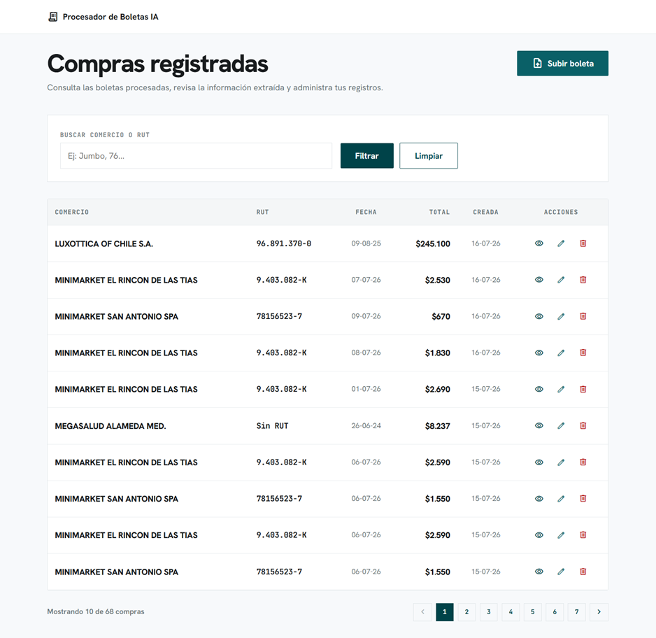
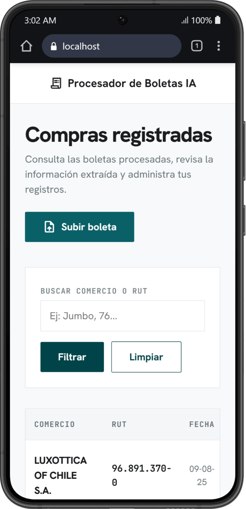
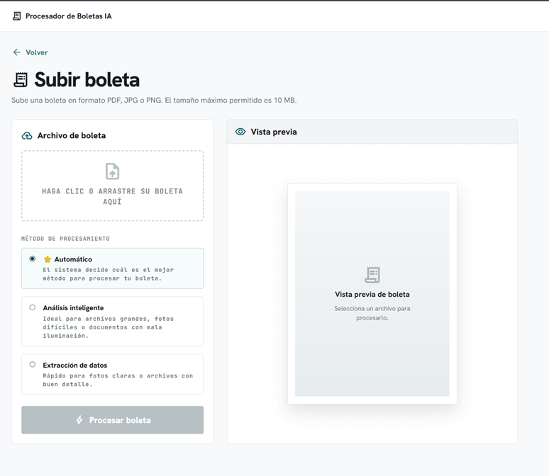
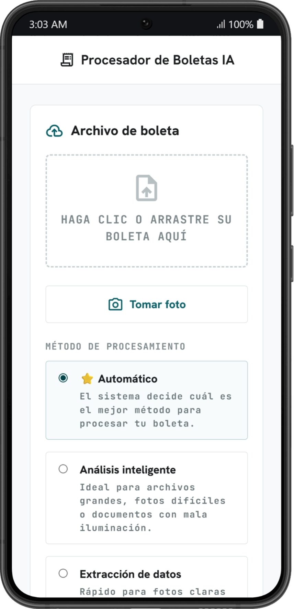
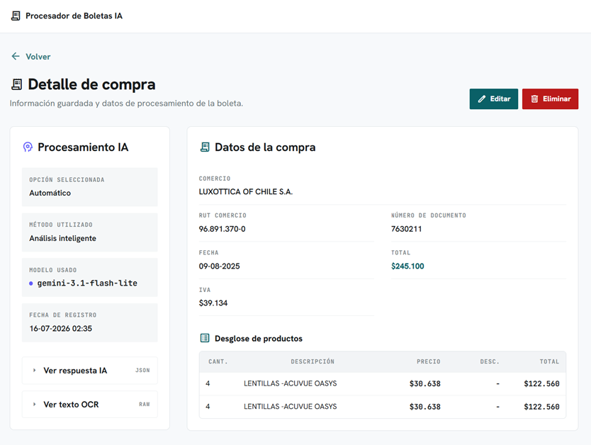
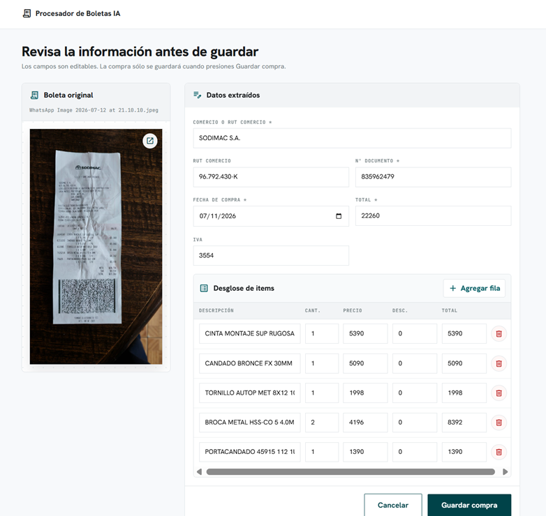

# Procesador de Boletas IA

Aplicación web en Ruby on Rails para subir boletas chilenas, vouchers o comprobantes de compra en PDF, JPG o PNG, procesarlos con IA/OCR, revisar los datos detectados y guardar la compra en PostgreSQL.

Demo producción: https://lector-boletas-ia.onrender.com/

La demo puede estar protegida con una clave de acceso compartida, entregada directamente por seguridad.

## Funcionalidades

- Subida de archivos PDF, JPG y PNG.
- Procesamiento de boletas, facturas, tickets y vouchers de compra.
- Clasificación del tipo de documento antes de extraer datos.
- Extracción de comercio, RUT, número de documento, fecha, total, IVA e ítems.
- Formulario editable antes de guardar.
- Validaciones para evitar registros vacíos o incompletos.
- Advertencia no bloqueante si la suma de ítems no coincide con el total.
- Listado, búsqueda, edición y eliminación de compras.
- Acceso protegido opcional por clave compartida.

## Stack

- Ruby `ruby-4.0.5`
- Rails `~> 8.1.3`
- PostgreSQL
- Supabase como base de datos en producción
- Render para despliegue
- Gemini para análisis visual de documentos
- OCR.space para extracción OCR
- Groq para estructurar texto extraído por OCR

## Requisitos

- Ruby compatible con `.ruby-version`
- Bundler
- PostgreSQL local o una URL de PostgreSQL externa
- Claves de API para Gemini, Groq y OCR.space

## Instalación Local

1. Instalar dependencias:

```bash
bundle install
```

2. Crear archivo de variables de entorno:

```bash
cp .env.example .env
```

3. Configurar `.env` con las variables necesarias.

4. Crear y migrar la base de datos:

```bash
bundle exec rails db:create db:migrate
```

5. Levantar la aplicación:

```bash
bundle exec rails server
```

La aplicación queda disponible en `http://localhost:3000`.

## Variables de Entorno

El proyecto incluye `.env.example` como referencia.

Variables principales:

```txt
DATABASE_PASSWORD=
DATABASE_URL=
GEMINI_API_KEY=
GROQ_API_KEY=
OCR_SPACE_API_KEY=
AI_ENGINE=auto
APP_ACCESS_LOCK_ENABLED=false
APP_ACCESS_PASSWORD=
```

En producción, estas variables están configuradas directamente en Render.

`DATABASE_URL` apunta a PostgreSQL alojado en Supabase.

`AI_ENGINE=auto` es el modo recomendado. En este modo la aplicación decide el método de procesamiento según el archivo. También existen `vision` y `ocr_text` para forzar un método específico.

## Uso

1. Entrar a la aplicación.
2. Subir una boleta, factura, ticket, voucher o comprobante de compra.
3. La aplicación procesa el archivo con IA/OCR.
4. Se muestra un formulario precargado con los datos detectados.
5. El usuario revisa, corrige o completa los campos faltantes.
6. La compra se guarda en PostgreSQL.
7. Las compras guardadas se pueden consultar, editar o eliminar.

## Validaciones al Guardar

Para evitar registros vacíos, al guardar se exige:

- Comercio o RUT del comercio. Basta con uno de los dos.
- Número de documento.
- Fecha de compra.
- Total mayor que `0`.

Reglas adicionales:

- El IVA es opcional.
- Si el IVA existe, debe ser mayor o igual a `0`.
- Si el IVA existe, no puede ser mayor que el total.
- Los ítems son opcionales.
- No se valida el formato del RUT para facilitar la demo.


## Cómo se Resolvió el Problema

El procesamiento se divide en dos etapas.

Primero se clasifica el documento para distinguir compras reales de documentos no válidos para el flujo, como transferencias bancarias, reembolsos de seguro, cotizaciones, certificados o documentos informativos.

Después, sólo si el documento corresponde a una compra o voucher de compra, se extraen los datos relevantes:

- comercio
- RUT
- número de documento
- fecha
- total
- IVA
- productos o servicios

La extracción automática no guarda directamente en la base de datos. Siempre pasa por un formulario editable para que el usuario pueda revisar y corregir antes de guardar.

## Prompt de IA

El prompt principal está ubicado en:

```txt
config/prompts/receipt_extraction.txt
```

Resumen de las instrucciones usadas:

- Devolver exclusivamente JSON válido.
- Clasificar primero el documento con `document_type`, `is_purchase_receipt`, `confidence` y `rejection_reason`.
- Usar valores cerrados para `document_type`, como `receipt`, `invoice`, `ticket`, `payment_voucher`, `card_receipt`, `bank_receipt`, `bank_transfer`, `insurance_reimbursement`, `quote`, `unknown`, entre otros.
- Rechazar documentos que no sean compras, aunque tengan fecha, montos o productos.
- Extraer datos sólo si `is_purchase_receipt` es `true`.
- No inventar datos.
- Usar `null` cuando un dato no esté disponible o no sea confiable.
- No tratar líneas como `Compra`, `Neto`, `IVA`, `Subtotal` o `Total` como productos.
- Usar la fecha de compra/emisión o, en vouchers, la fecha de transacción.
- En vouchers, usar número de operación, autorización, comprobante o transacción como `document_number` si corresponde.

Ejemplo breve de salida esperada:

```json
{
  "document_type": "receipt",
  "is_purchase_receipt": true,
  "confidence": 0.96,
  "rejection_reason": null,
  "merchant_name": "SUPERMERCADO EJEMPLO SPA",
  "merchant_rut": "76123456-7",
  "document_number": "123456",
  "purchase_date": "2026-07-06",
  "total_amount": 8990,
  "tax_amount": 1435,
  "items": [
    {
      "description": "Pan integral",
      "quantity": 1,
      "unit_price": 1990,
      "discount_amount": 0,
      "total_price": 1990
    },
    {
      "description": "Leche entera 1L",
      "quantity": 2,
      "unit_price": 1250,
      "discount_amount": 0,
      "total_price": 2500
    },
    {
      "description": "Cafe instantaneo",
      "quantity": 1,
      "unit_price": 4500,
      "discount_amount": 0,
      "total_price": 4500
    }
  ]
}
```

Ejemplo de documento rechazado:

```json
{
  "document_type": "bank_transfer",
  "is_purchase_receipt": false,
  "confidence": 0.98,
  "rejection_reason": "El documento parece corresponder a un comprobante de transferencia bancaria.",
  "merchant_name": null,
  "merchant_rut": null,
  "document_number": null,
  "purchase_date": null,
  "total_amount": null,
  "tax_amount": null,
  "items": []
}
```

## Producción

La aplicación está desplegada en Render:

```txt
https://lector-boletas-ia.onrender.com/
```

La base de datos de producción usa PostgreSQL alojado en Supabase.

Las variables de entorno de producción están configuradas en Render. La clave de acceso de la demo no se publica en el repositorio y se entrega directamente por seguridad.


## Mejoras Futuras

## Capturas

<table>
  <tr>
    <td width="70%">
      
    </td>
    <td width="30%">
      
    </td>
  </tr>
  <tr>
    <td width="70%">
      
    </td>
    <td width="30%">
      
    </td>
  </tr>
</table>




